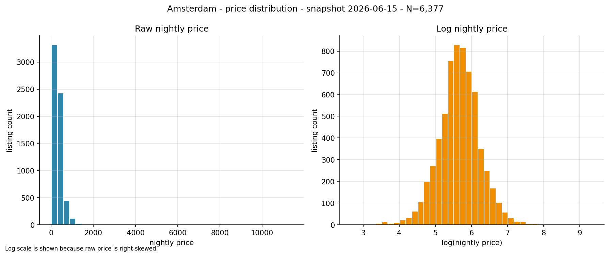
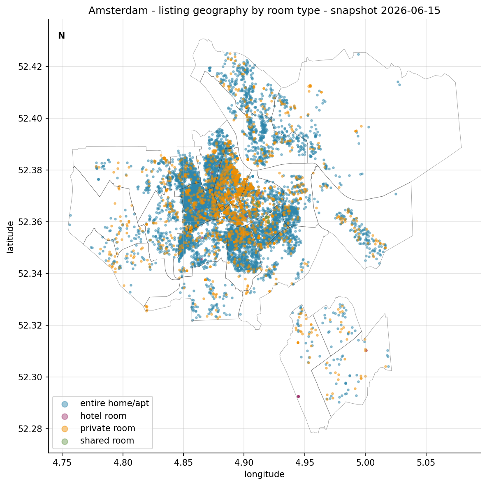
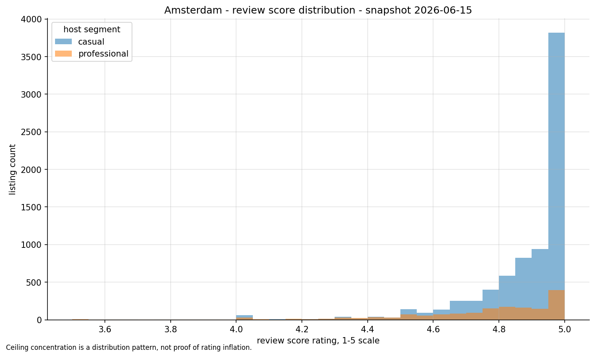
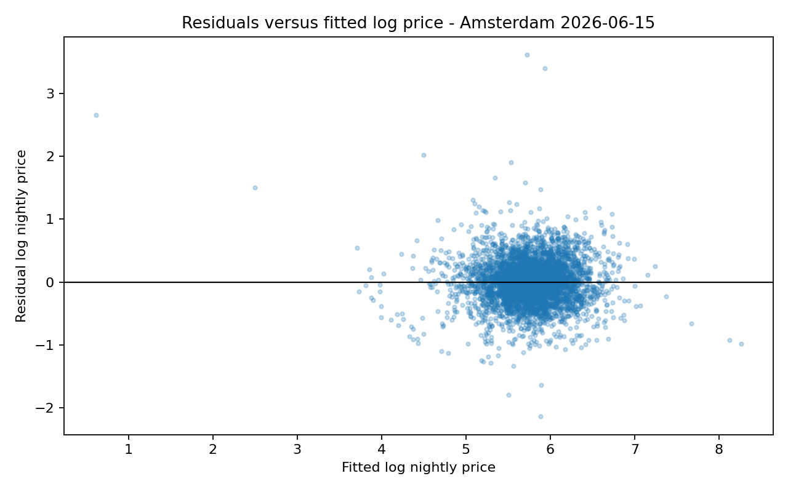

# Airbnb Market Intelligence Pipeline

[](https://www.python.org/)
[](https://duckdb.org/)
[](https://pandas.pydata.org/)
[](https://parquet.apache.org/)
[](https://scikit-learn.org/)
[](https://www.statsmodels.org/)
[](https://streamlit.io/)
[](#quality-checks)
[](https://docs.astral.sh/ruff/)

A reproducible **Inside Airbnb data engineering and analytics pipeline** for short-term rental
market intelligence. The project turns public Airbnb listing, calendar, review, and
neighbourhood data into traceable data products: raw-source provenance, staged files,
data-quality reports, typed Parquet outputs, a DuckDB star schema, SQL business summaries,
statistical analysis, machine-learning benchmarks, static figures, and a local Streamlit dashboard.

The current analytical case is **Amsterdam, snapshot 2026-06-15**. The pipeline is
configuration-driven, so another city can be added through `configs/cities.yml` without changing
Python code.

> [!NOTE]
> Raw Inside Airbnb files, staged CSV files, processed Parquet files, local DuckDB databases, and
> final report documents are intentionally excluded from version control. The repository contains
> reproducible code, documentation, SQL, tests, and generated lightweight analysis artifacts.

---

## What This Project Demonstrates

- **Data engineering**: repeatable ingestion, SHA-256 checksums, manifests, metadata, idempotent
  reruns, Parquet outputs, and a DuckDB analytical model.
- **Data quality**: profiling, schema documentation, validation rules, missing/invalid distinction,
  duplicate signals, outlier reporting, and explicit quarantine handling.
- **Analytics engineering**: star schema design, SQL business queries, lineage, assumptions, and
  decision logs.
- **Exploratory analysis**: price, host, review, geography, availability, and demand-proxy analysis
  with reusable Python functions.
- **Statistical analysis**: hypothesis tests, confidence intervals, effect sizes, multiple-testing
  correction, OLS diagnostics, robust errors, VIF, residual analysis, and non-causal interpretation.
- **Machine learning**: leakage-aware nightly-price prediction with baseline, regularised linear
  model, random forest, histogram gradient boosting, cross-validation, error slices, and feature
  importance.
- **Dashboarding**: a local Streamlit dashboard over generated processed outputs only.

---

## Example Outputs

### Price Distribution



The Amsterdam listing price distribution is heavily right-skewed. The project therefore reports
medians, quartiles, confidence intervals, and log-price models instead of relying only on raw
averages.

### Geographic Supply Pattern



The geographic view helps inspect listing concentration by neighbourhood. Coordinates are treated
as approximate source coordinates, not exact property locations.

### Review Score Concentration



Review scores are concentrated near the top of the scale, so the analysis treats rating fields as
useful but limited quality signals.

### Model Diagnostics



The OLS model is used for transparent association analysis, not causal inference. The residual
plots and VIF table make model limitations visible.

---

## Architecture

```text
Inside Airbnb source URLs
        |
        v
Configuration
configs/cities.yml
        |
        v
Ingestion
data/raw/<city>/<snapshot>/ + data/staged/<city>/<snapshot>/manifest.json
        |
        v
Profiling and validation
reports/profiles/ + reports/data_quality_report.md + validation outputs
        |
        v
Cleaning and enrichment
data/processed/<city>/*.parquet
        |
        v
DuckDB analytical model
db/airbnb.duckdb + sql/schema.sql + sql/business_queries.sql
        |
        v
Analysis artifacts
reports/tables/*.csv + reports/figures/*.png + reports/*.md
        |
        v
Optional dashboard
dashboard_app.py
```

The architecture is intentionally local and lightweight. It uses Python, pandas, PyArrow, DuckDB,
SciPy, statsmodels, scikit-learn, Matplotlib, seaborn, RapidFuzz, and Streamlit. No cloud account,
paid API key, distributed system, or orchestration framework is required.

---

## Repository Structure

```text
configs/                  City and source-file configuration
data/sample/              Tiny sample placeholder only
docs/                     Architecture, assumptions, lineage, data dictionary, decisions
notebooks/                Lightweight narrative notebooks, not pipeline implementations
reports/                  Generated analysis summaries, tables, and figures
scripts/                  Report generation helper
sql/                      DuckDB schema and business queries
src/airbnb_intelligence/  Reusable pipeline, analysis, and dashboard logic
tests/                    Deterministic fixture-based tests
dashboard_app.py          Local Streamlit dashboard entry point
Makefile                  Common developer commands
pyproject.toml            Package metadata and tool configuration
```

---

## Data Sources

This project uses public Inside Airbnb city snapshot files:

- detailed listings
- summary listings
- calendar
- detailed reviews
- summary reviews
- neighbourhoods
- neighbourhood GeoJSON

The configured Amsterdam source URLs and snapshot date live in:

```text
configs/cities.yml
```

The source schema and business meaning of each file are documented in:

```text
docs/data_dictionary.md
```

---

## Quick Start

### 1. Clone the Repository

```bash
git clone https://github.com/deaneeth/airbnb-market-intelligence-pipeline.git
cd airbnb-market-intelligence-pipeline
```

### 2. Create a Virtual Environment

Windows PowerShell:

```powershell
python -m venv .venv
.venv\Scripts\Activate.ps1
```

Linux or macOS:

```bash
python -m venv .venv
source .venv/bin/activate
```

### 3. Install Dependencies

```bash
python -m pip install --upgrade pip
python -m pip install -e ".[dev]"
```

### 4. Confirm the CLI

```bash
airbnb-pipeline --help
```

---

## Run the Pipeline

Run the complete workflow:

```bash
airbnb-pipeline run
```

Or run each command separately:

```bash
airbnb-pipeline download
airbnb-pipeline profile
airbnb-pipeline validate
airbnb-pipeline transform
airbnb-pipeline enrich
airbnb-pipeline load
airbnb-pipeline analyse
```

Equivalent Make targets:

```bash
make run-download
make run-profile
make run-validate
make run-transform
make run-load
make run-analyse
```

---

## Key Outputs

| Output | Purpose |
|---|---|
| `data/staged/<city>/<snapshot>/manifest.json` | Source URL, file size, checksum, status, and provenance |
| `data/processed/<city>/listings_master.parquet` | Cleaned and enriched listing-level table |
| `data/processed/<city>/calendar_agg.parquet` | Listing-month calendar aggregation |
| `data/processed/<city>/listings_quarantine.parquet` | Excluded rows with source row identifier and reason |
| `db/airbnb.duckdb` | Local analytical DuckDB database |
| `reports/profiles/<city>/<snapshot>/profile.json` | Machine-readable data profile |
| `reports/data_quality_report.md` | Human-readable data-quality summary |
| `reports/validation_report.json` | Structured validation result |
| `reports/tables/*.csv` | SQL, EDA, statistics, OLS, and ML result tables |
| `reports/figures/*.png` | Static analysis figures |
| `reports/ml_model_card.md` | Predictive experiment model card |

---

## Data Quality and Validation

The pipeline validates the source data before analysis. It checks:

- missing required identifiers
- invalid listing prices after parsing
- invalid latitude and longitude ranges
- negative availability and minimum-night values
- invalid dates
- review-score ranges
- join coverage between calendar/reviews and listings
- exact duplicates using stable source identifiers
- conservative fuzzy duplicate signals using blocked record pairs
- unusual but plausible outliers for price, availability, minimum nights, review count, and review
  frequency

The profiler does not delete data. Cleaning and analysis decisions are documented in:

```text
docs/assumptions.md
docs/decision_log.md
docs/lineage.md
```

---

## Analytical Model

DuckDB is used as the local analytical engine. The model is designed for repeatable business
queries over the processed Parquet outputs.

Core tables include:

- listing dimension
- host dimension
- neighbourhood dimension
- date dimension
- listing snapshot fact
- monthly calendar fact

SQL lives in:

```text
sql/schema.sql
sql/business_queries.sql
```

Generated business query outputs are written to:

```text
reports/tables/Q*.csv
```

---

## Statistical and ML Methods

The analysis includes:

- price confidence intervals by room type and neighbourhood
- planned hypothesis tests with effect sizes and adjusted p-values
- Benjamini-Hochberg false-discovery-rate correction
- conservative sensitivity checks where useful
- OLS log-price association model with robust standard errors
- VIF diagnostics and residual summaries
- leakage-aware price prediction with four model families:
  - median-price baseline
  - regularised linear regression
  - random forest regressor
  - histogram gradient boosting regressor

The predictive experiment is intentionally framed as a benchmark, not a production pricing system.
Feature importance is interpreted as predictive association, not causal evidence.

---

## Local Dashboard

After processed outputs exist, run:

```bash
make run-dashboard
```

The Streamlit dashboard reads only generated processed Parquet outputs. It includes:

- neighbourhood and room-type filters
- KPI cards
- price distribution
- supply and price tables
- monthly availability trend
- short interpretation panel

---

## Quality Checks

Run the full test suite:

```bash
python -m pytest tests/ -v --basetemp=.pytest_tmp
```

Run linting:

```bash
python -m ruff check src/ tests/ conftest.py scripts/build_report.py
```

Last verified locally:

```text
120 tests passed
ruff: all checks passed
```

---

## Reproducibility Notes

- The configuration file is the source of truth for city names, snapshot dates, and source URLs.
- Raw files are saved without altering source bytes.
- Gzip files are extracted into staged paths.
- Source provenance and SHA-256 checksums are recorded.
- Existing files are skipped when checksums match.
- Processed outputs retain city, snapshot date, and source-derived lineage.
- Large calendar and review files are processed with memory-aware policies.

---

## Important Caveats

- The current analysis is based on one city snapshot.
- `availability_rate` is host-set availability, not confirmed booking activity.
- `occupancy_proxy` is derived from host-set availability and is not confirmed booked nights.
- `revenue_proxy` is estimated from availability proxy and calendar price; it is not observed
  revenue.
- `review_frequency` is reviews per month as reported by Inside Airbnb and is only a demand signal
  proxy.
- OLS coefficients, statistical associations, and ML feature importance are not causal evidence.
- Geographic coordinates are source coordinates and should not be treated as exact property
  locations.

---

## Recommended Review Path

For a fast technical review:

1. Read `docs/architecture.md`.
2. Inspect `configs/cities.yml`.
3. Open `docs/data_dictionary.md`.
4. Review `reports/data_quality_report.md`.
5. Inspect `sql/schema.sql` and `sql/business_queries.sql`.
6. Browse `reports/figures/` and `reports/tables/`.
7. Read `reports/ml_model_card.md`.
8. Run `make test`.
9. Run `airbnb-pipeline run` after downloading source data.
